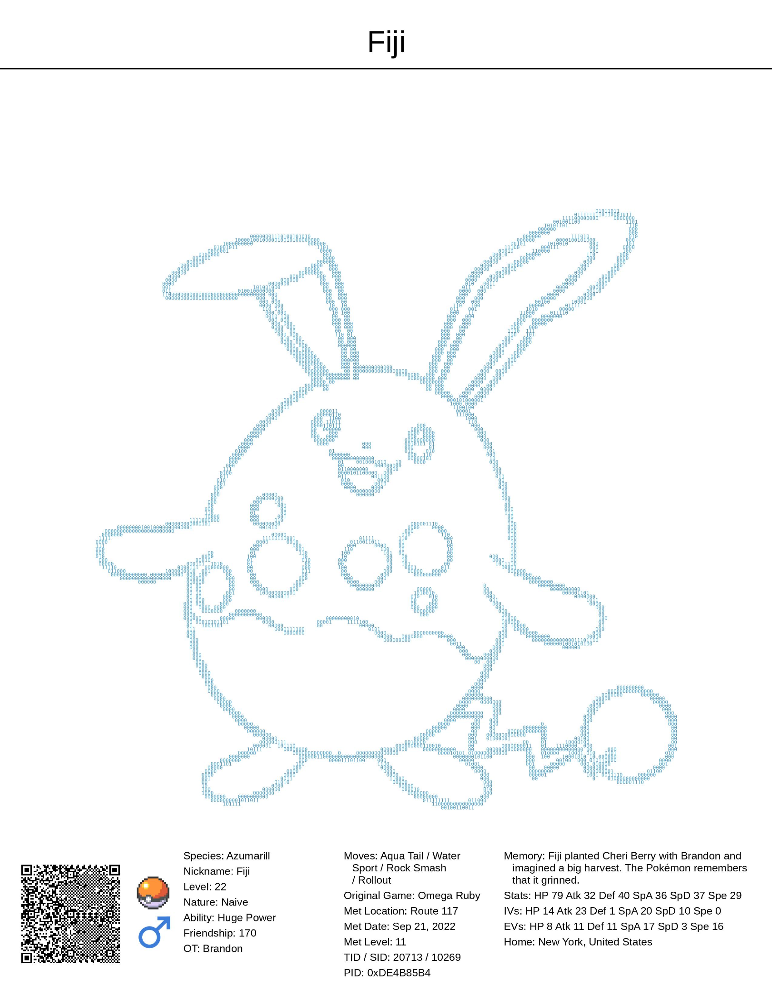
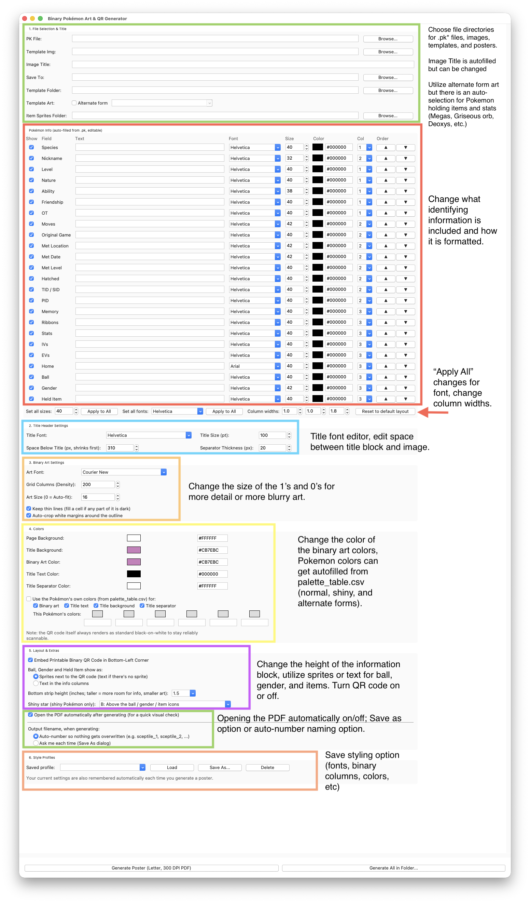
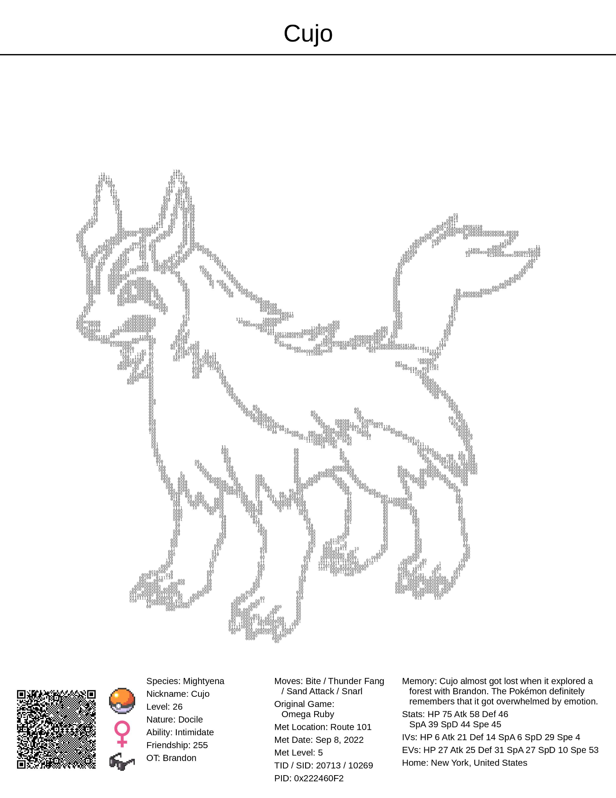
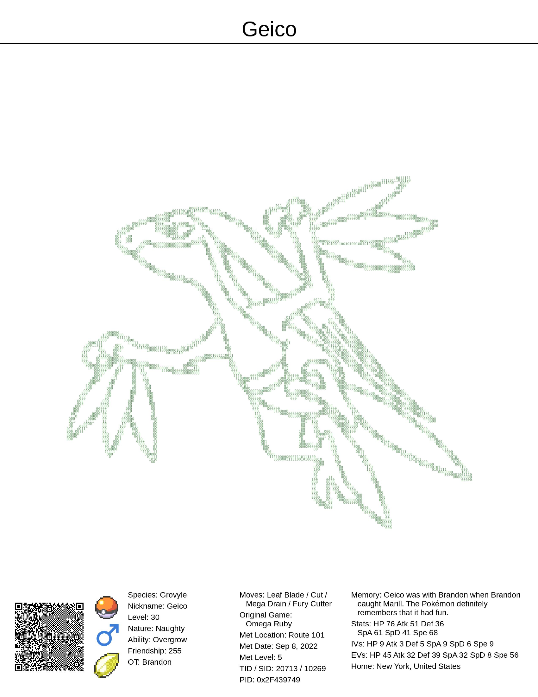
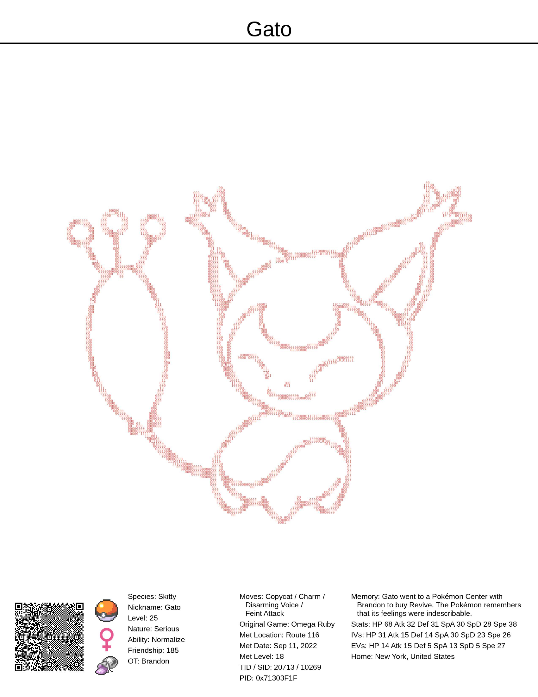
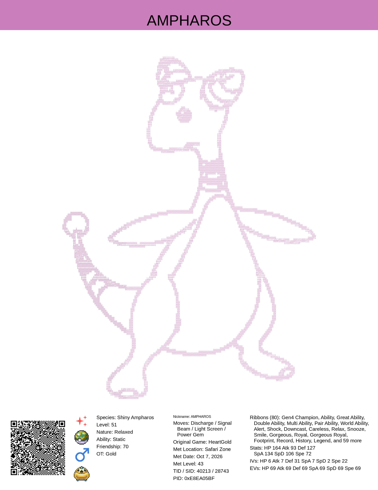
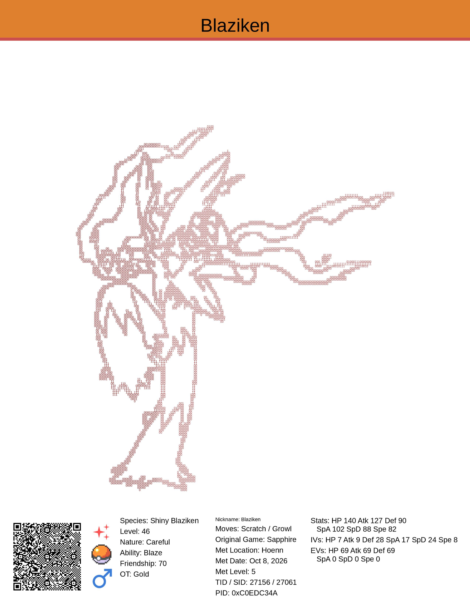
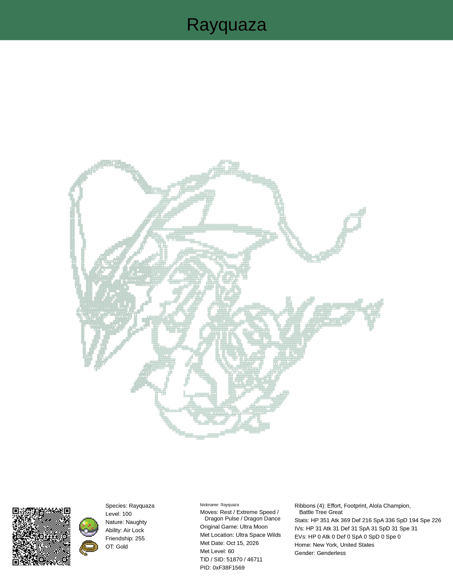

# Pokémon Tombstone

Turn your Pokémon into a printable poster. Each poster shows the Pokémon's outline drawn
with the 1s and 0s of its save file, its name, an info strip (trainer, where it was met,
moves, IVs, ribbons and more) and a QR code that holds the whole Pokémon.

Free, non-commercial fan project. Not affiliated with Nintendo, Game Freak, Creatures or
The Pokémon Company.




## What it can do

- **Keeps your Pokémon forever on paper.** The QR code holds the whole `.pk` file, so the poster
  is also a backup: a QR reader that saves raw data can turn it back into the `.pk` file
  (for example the companion web app [QR Bank](https://pkqrbank.github.io)).


- **Reads Gen 1 to 7 files** (`.pk1`–`.pk7`) and fills in the info strip for you: species,
  nickname, level, nature, ability, moves, IVs, EVs, stats, OT and IDs, where and when it was met,
  ribbons, memories and more. Every field can be edited, hidden, moved between columns or restyled.
- **Picks the right outline**, including regional, gender and other forms, Mega Evolutions and
  Primal forms (from the held stone or orb), with an "Alternate form" box to choose another.
- **Uses the Pokémon's own colors** if you want: 6 colors per Pokémon (normal and shiny) for the
  art, title and title bar, with copyable hex codes.
- **Ball, gender and held item** as pictures or text, plus an optional shiny star.
- **Makes posters in bulk**: "Generate All in Folder" does a whole box or living dex at once.
- **Saves your styles** as profiles, so every poster in a set matches.

## Download

Click the link for your computer. Nothing else to install. The app works on its own, but ball and
item pictures need the item PNGs from PokéAPI (see Extra downloads). The apps include the outline
templates used to draw the binary art. To download the outline template "coloring pages" on their
own, go to the Extra downloads section.

- **Windows:** [Download for Windows](https://github.com/szwbzv4vcm-code/pk-tombstone/releases/latest/download/Binary-Art-Generator-Windows.exe). Double-click the downloaded file. If Windows says
  "Windows protected your PC", click **More info**, then **Run anyway**.
- **Mac:** [Download for Mac](https://github.com/szwbzv4vcm-code/pk-tombstone/releases/latest/download/Binary-Art-Generator-Mac.zip). Double-click the zip to unzip it, then drag
  **Binary Art Generator** into Applications and open it. The first time, macOS says it can't
  check the app: click **Done**, open **System Settings > Privacy & Security**, scroll down and
  click **Open Anyway**.

These warnings appear because the app isn't signed with a paid Apple or Microsoft certificate.

## Make your first poster



1. Export your Pokémon as a `.pk` file with [PKHeX](https://github.com/kwsch/PKHeX)
   (Gen 1 to 7: `.pk1` to `.pk7`).
2. Open the app. Next to **PK File**, click **Browse...** and pick your file.
3. Click **Generate Poster**. The PDF (US Letter) opens when it's done.

"Generate All in Folder..." makes a poster for every `.pk` file in a folder.
Ball and held item print as text, unless you add the item pictures (see below).

## Extra downloads (optional)

**Outline templates:** the apps already include them. To look at or copy them without
downloading them again:

- **Mac:** right-click **Binary Art Generator** in Applications, choose **Show Package Contents**,
  then open **Contents > Resources > templates**. Copy that folder anywhere you like
  (copy, don't move, or the app loses its templates).
- **Windows:** the templates are packed inside the `.exe` and only unpacked while the app is open.
  Open the app, select everything in the **Template Folder** box and copy it (Ctrl+C), paste it
  into File Explorer's address bar and press Enter. You're now in the templates folder: press
  Ctrl+A, then Ctrl+C, and paste into a new folder of your own. Do this before closing the app,
  because Windows deletes the unpacked copy when the app closes.

Or download them on their own:
[Download templates.zip](https://github.com/szwbzv4vcm-code/pk-tombstone/releases/download/templates/templates.zip)
(1,386 outlines). Unzip it and pick the folder as the **Template Folder**.
Some forms don't have an outline yet or are unfinished: see
[templates_to_do.txt](https://github.com/szwbzv4vcm-code/pk-tombstone/releases/download/templates/templates_to_do.txt).

**Ball and item pictures + official artwork:** to use the app fully, download the item PNGs from
[PokéAPI's sprites](https://github.com/PokeAPI/sprites). The official artwork is optional; those are
the PNGs I used to create the outlines.
You need [Git](https://git-scm.com/downloads) (Mac: it installs itself the first time you type `git`).
Open Terminal (Mac) or PowerShell (Windows) and paste one or both blocks, in any order.

Item pictures (needed for ball and item pictures):

```
git clone --depth 1 --filter=blob:none --sparse https://github.com/PokeAPI/sprites.git $HOME/pokeapi-sprites
cd $HOME/pokeapi-sprites
git sparse-checkout add sprites/items
```

Official artwork (optional, fun to have on hand; about 500 MB):

```
git clone --depth 1 --filter=blob:none --sparse https://github.com/PokeAPI/sprites.git $HOME/pokeapi-sprites
cd $HOME/pokeapi-sprites
git sparse-checkout add sprites/pokemon/other/official-artwork
```

If you run the second block after the first, its `git clone` line says the folder already exists.
That's fine: the next two lines still add the artwork.

You get a `pokeapi-sprites` folder in your home folder with:

- `sprites/items`: ball and item pictures. The app finds this folder by itself (restart the app
  after downloading). If you put it somewhere else, click **Browse...** next to
  **Item Sprites Folder** and pick it. Balls and held items then show as pictures instead of text.
- `sprites/pokemon/other/official-artwork` (normal) and `.../official-artwork/shiny`: the
  full-color artwork. The app doesn't need it (its colors are already built in); it's only used to
  rebuild the color table with `make_palette_table.py`.

## Example posters

<p>






</p>
  

## Notes

- Gen 8 and 9 files aren't read yet.
- Gen 7 trainer IDs show the raw 5-digit number, not the 6-digit in-game ID.
- PKHeX was used as the reference for how the games store data.

## For developers

### Files

| File | What it does |
|---|---|
| `binary_art_generator_p1.py` | The poster program (Tk window) |
| `inspect_pk.py` | Prints everything read from a `.pk` file |
| `make_palette_table.py` | Rebuilds `pk_reader/palette_table.csv` from official artwork |
| `pk_reader/` | Reads `.pk1`–`.pk7` files, plus its data tables |

Outline templates aren't in the code. Get `templates.zip` from the "Outline templates"
release, unzip it into a folder named `templates` next to `binary_art_generator_p1.py`
(or pick it as the Template Folder). Ball and item pictures are optional: pick PokéAPI's `sprites/items` folder as the
**Item Sprites Folder** (see Extra downloads).

### Run from source

You need Python 3.10 or newer (python.org installers include Tk).

Mac:

```
python3 -m venv .venv
source .venv/bin/activate
pip install -r requirements.txt
python3 binary_art_generator_p1.py
```

Windows (PowerShell; tick "Add python.exe to PATH" when installing Python):

```
py -m venv .venv
.venv\Scripts\Activate.ps1
pip install -r requirements.txt
py binary_art_generator_p1.py
```

If PowerShell refuses to run `Activate.ps1`, run
`Set-ExecutionPolicy -Scope CurrentUser RemoteSigned` once.

To see what the reader finds in a file: `python3 inspect_pk.py "path/to/File.pk7"`.

### Builds

Pushing a tag like `v0.2` builds the Windows and Mac apps with GitHub Actions
(`.github/workflows/build.yml`) and attaches them to a release.
